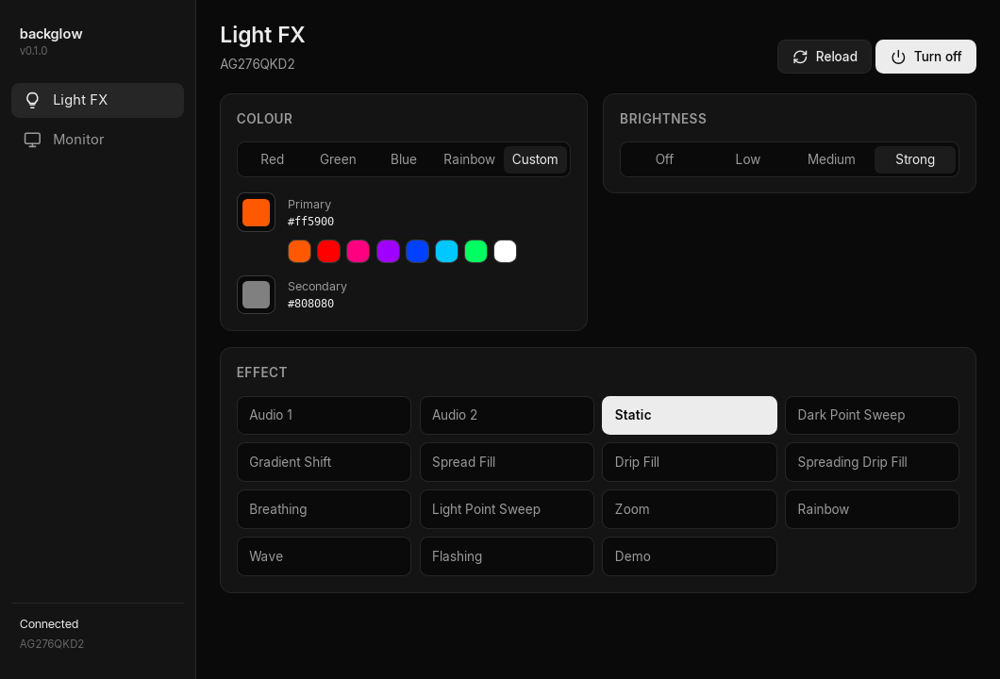

# backglow

Light FX control for **AOC AGON** monitors on Linux.

AOC's G-Menu is Windows-only. backglow drives the monitor's rear lighting directly over DDC/CI, the same channel the display cable already uses for brightness and input switching, so it needs no vendor software, no USB cable and no kernel driver.



## Features

- Every Light FX effect the monitor offers (Static, Breathing, Spread Fill, Rainbow, Wave and the rest)
- Brightness: off, low, medium, strong
- Red, green, blue, rainbow or a custom colour, with presets
- White balance correction so `#ffffff` looks white on the LEDs
- Command line control for scripts and keybinds
- Finds the monitor automatically by its EDID

## Supported monitors

| Model             | Status  |
|-------------------|---------|
| AOC AGON PRO AG276QKD2 | Tested |

Other AGON monitors that expose Light FX over DDC/CI should work. backglow reads the number of effects from the monitor and picks the matching list. Please open a monitor report if you try one.

## Requirements

- Linux with the `i2c-dev` kernel module loaded
- A monitor connected over DisplayPort or HDMI with DDC/CI enabled in its menu
- Python 3.10+, PyGObject, pywebview
- WebKitGTK 4.1
- A udev rule granting your user access to the GPU's i2c buses

## Installation

### Nix

```sh
nix run github:owainxyz/backglow
```

### NixOS

The module installs the application and the udev rule, and loads `i2c-dev`.

```nix
{
  inputs.backglow.url = "github:owainxyz/backglow";

  outputs = { nixpkgs, backglow, ... }: {
    nixosConfigurations.host = nixpkgs.lib.nixosSystem {
      modules = [ backglow.nixosModules.default ];
    };
  };
}
```

### Other distributions

Install WebKitGTK 4.1 and PyGObject from your package manager, then:

```sh
pip install --user .
echo i2c-dev | sudo tee /etc/modules-load.d/i2c-dev.conf
sudo modprobe i2c-dev
sudo cp 60-backglow.rules /etc/udev/rules.d/
sudo udevadm control --reload
sudo udevadm trigger
```

## Usage

```sh
backglow                                  # open the app
backglow --status                         # model, brightness, effect, colour
backglow --mode "spread fill"             # effect by name or number
backglow --strength off                   # off, low, medium, strong
backglow --pattern rainbow                # red, green, blue, rainbow, custom
backglow --colour ff5900                  # custom colour
backglow --colour2 ffffff                 # secondary colour, for effects that use one
```

Settings are stored in the monitor itself and survive power cycles.

## Protocol

AOC exposes Light FX as manufacturer-specific DDC/CI features with three-byte codes on page `F8 E1`. See [docs/PROTOCOL.md](docs/PROTOCOL.md).

## Documentation

- [Protocol reference](docs/PROTOCOL.md)
- [Troubleshooting](docs/TROUBLESHOOTING.md)
- [Changelog](CHANGELOG.md)

## Contributing

Contributions are welcome. Read [CONTRIBUTING.md](CONTRIBUTING.md) before opening a pull request, and see [AGENTS.md](AGENTS.md) if you use a coding agent. Security issues should be reported as described in [SECURITY.md](SECURITY.md).

This project follows a [Code of Conduct](CODE_OF_CONDUCT.md).

backglow is not affiliated with AOC or TPV. AOC and AGON are trademarks of their owners.

## License

[MIT](LICENSE)
